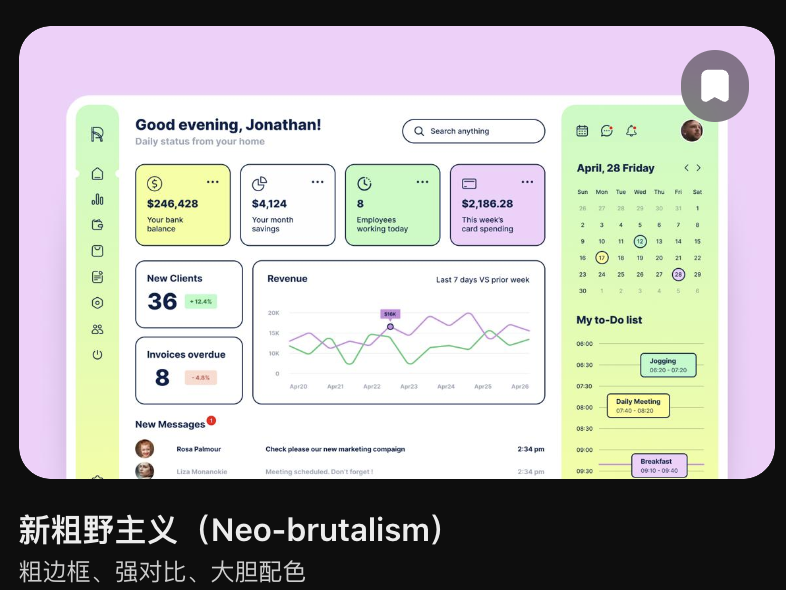

# 家庭首页 C 端体验与移动端改版提案

日期：2026 年 10 月 23 日  
状态：已实施；首轮记录见第 11 节，参考图与小组件修订见第 12 节，聊天样式统一见第 13 节  
实施顺序：第 2 项，在 009 的 P0–P3 验收通过后实施

编号调整：本文由原 009 调整为 010；家庭备忘改造由原 010 调整为 [009 家庭管家事项清单改造计划](009-family-task-ledger-implementation-plan.md)。实施先后以功能验收为准，不按原编号顺序推进；当前工作区已有事项实现，是否完成 009 仍需以验收结果确认。

## 0 前置功能与本计划边界

先完成 009 的个人/家庭空间、有时效/无时效备忘、`"/ "` 显式工具命令、`"@ "` 多成员指定、事项完成、每周周期、权限与迁移，以及现有工作台中的最小可用事项视图，再启动本文的界面整理。

本文复用 009 已实现的数据模型、工具、API、查询与业务组件，只调整首页结构、导航、视图编排和视觉表现。不能为了开始备忘功能先完成本改版，也不能在本计划中再次开发一套事项业务。

当前仍不做主动通知。下文关于通知配置、未读总数、送达状态、推送深链接的描述保留为旧界面评审背景，不属于本轮交付或验收；009 完成后已关闭/隐藏的发送能力不在此重新启用。有关旧提醒与任务统计的描述，实施时以 009 的事项/实例模型和统一查询为准。正文代码行号是评审时的快照，开工时需对照 009 完成后的代码复核。

当前家庭首页面向 C 端普通用户，手机是核心使用场景。改版的首要目标是建立主次，让用户轻松看懂、愿意使用；不能以后台工作台的参数密度组织界面。首页收敛为“需要关注的事 + 紧凑 Agent 输入 + 少量常用入口”，完整清单、编辑表单、历史记录与设置分别进入对应视图。继续保留现有对话覆盖层，让用户从家庭事务进入对话，结束后回到更新后的家庭状态。

本建议针对原评审截图与 React 实现，并于本日纳入用户关于 C 端定位、参数过度展示、移动端缺失和混合风格的反馈。它承接 [008 家庭 Agent 主界面布局替代方案](008-home-agent-layout-alternatives.md) 的“事务底层 + 对话上层”关系；视觉方向以本文 0.2 的参考图、0.3 的混合风格分工及第 6 节规范为准，替代 [006 前端苹果风视觉改版需求](006-frontend-apple-style-redesign-requirements.md) 中与其冲突的外观约定，继续复用主题能力与可访问性要求。以下为改版设计依据；实际交付与验证见第 11 节。

### 0.1 产品定位与设计优先级

用户指出的“乱”，核心是所有信息和参数几乎处于同一层级：重要事项、辅助属性、筛选条件、技术配置都要求用户立即阅读。即使删掉几张卡片，只要这种呈现方式不变，界面仍然会拥挤。

本次按以下顺序做设计取舍：

1. **先看懂**：每屏有明确的视觉重心，用户一眼知道需要关注什么、下一步能做什么。
2. **再操作**：常见动作直接可用；更多属性与复杂规则在需要时出现。
3. **保持美观**：用字号、留白、对齐、明确描边与有分工的色块形成层级，避免每个属性都变成标签或卡片。
4. **手机优先验证**：先设计窄屏的信息顺序与触控流程，再扩展到桌面；不能到最后只补媒体查询。

视觉主张：采用“柔和新粗野主义 + Bento Grid + 现代极简交互”。米白与白色提供阅读背景，深色描边、圆角和少量柔和彩色建立辨识度；以大小有别的区域和清楚的文字形成主次。内容主线：简短状态 → 需要关注的事 → Agent 输入 → 常用入口。交互主张：参数逐步展开、点按查看详情、完成后就地反馈、关闭后回到原位置；动效解释操作与真实状态变化。

功能完整性通过分层入口保留，不要求所有能力同时可见。首页、业务列表、详情与设置都适用本原则，不能只精简首页、进入下一页又恢复整排参数。

### 0.2 用户认可的风格与布局参考

用户提供截图并明确表示“像这种风格和布局就很不错”，因此保留它作为分区、比例和边界处理的主要参考。结合后续混合风格建议，配色与控件参数统一采用第 6 节；图中原有淡紫外背景与薄荷绿分区不再作为必须逐色复刻的要求。



| 参考图特征 | 家庭产品中的采用方式 |
| --- | --- |
| 彩色外部背景 + 白色大圆角应用主体 | 保留背景与主体的层次，改用米白背景衬托白色主体；手机减小外部留边，把空间留给内容 |
| 窄导航、宽主区、右侧日历与待办 | 保留主次关系；大屏可增加轻量日程栏，手机将日程收为入口，不把三列全部向下堆叠 |
| 柔和彩色与深色文字/描边 | 采用第 6 节的浅蓝、浅黄、淡紫作为功能色，状态色单独定义；白色承担主要阅读背景 |
| 模块边界清楚、圆角统一、标题有分量 | 对真正独立的内容组使用描边容器，组内仍用简洁列表；字号与留白承担阅读顺序 |
| 少量卡片形成节奏 | 可以保留承载真实内容或直接操作的重点卡片，不恢复每项统计一个框的卡片阵列 |

截图中的银行数字、收入图表、员工指标等仅为示例业务内容，不带入家庭首页；黑色截图底板、底部风格说明与右上角书签浮标不属于产品界面。右侧日历属于可选的快捷查看，不自动扩为排程编辑器，也不引入主动通知。

本参考明确调整上一版“弱化所有边框、单一强调色、固定取消右栏”的建议：允许清晰描边、少量多彩色块和大屏轻量日程栏，同时继续遵守信息分层与手机优先原则。

### 0.3 混合风格的职责与使用边界

家庭首页需要支持长期使用，三种设计方式各自承担明确职责：

| 设计方式 | 负责什么 | 落地约束 |
| --- | --- | --- |
| 柔和新粗野主义 | 建立品牌辨识与可操作感 | 深色描边、柔和彩色、少量硬阴影集中于重点入口；普通内容保持轻量 |
| Bento Grid | 组织内容与空间主次 | 主区域占更大面积，辅助区域缩小；卡片大小由任务重要性与内容决定，避免等大卡片阵列 |
| 现代极简交互 | 降低理解和操作负担 | 常见操作直接可用，参数按需展开，详情逐层进入，保持可预测的反馈与返回路径 |

首页优先展示真实事务与 Agent 操作。对话、代码、日志和资源图表使用低干扰阅读表面，继续共用字体、主题与控件规范，通过装饰强度区分页面用途。运行进度必须来自真实执行状态；没有可量化进度时显示“处理中”等状态，不生成虚假百分比。

参考来源：[Neo-Brutalism Dashboard](https://dribbble.com/shots/21285880-Dashboard-in-Neo-Brutalism-style) 用于视觉分区；[Neobrutalism UI](https://neobrutalism.com/docs) 用于按钮、表单和按压反馈参考；[Tailwind Brutalism Dashboard](https://brutalism.tailwinddashboard.com/) 用于观察后台布局。按本项目需求选择局部做法，继续复用现有 React 组件；本计划不要求购买模板、切换组件库或迁移技术栈。

## 1 当前混乱来自哪里

### 1.1 首页同时承担了过多职责

截图中的主区依次展示页面标题、大幅 Agent 宣传区、四张状态卡、五张对象入口卡，再往下才是冰箱清单和操作表单。左侧同时放家庭导航与最近对话，右侧同时放通知配置、通知列表与活动摘要。

这些区域回答的是不同问题：“我能让 Agent 做什么”“今天要处理什么”“如何维护物品”“系统通知配置好了吗”。它们同时以完整面板出现，让首页缺少明确的阅读顺序。右侧的 VAPID 等配置字段甚至比下方实际事务更容易被看到。

### 1.2 多个区域重复表达同一入口

顶部“对话”、侧栏“新建 Agent 对话”、大输入框、四个快捷指令、四张状态卡和五张对象卡都可以进入聊天。用户看到的是多个功能模块，实际得到的往往只是不同的对话草稿。

状态数字也没有直接展开对应数据。想看临期物品，需要先进入对话；想看完整冰箱清单，却需要向下滚动。由此产生“入口很多，操作路径仍然很长”的感受。

### 1.3 名称与行为不一致

| 当前入口 | 代码中的实际行为 | 对用户的影响 |
| --- | --- | --- |
| 侧栏“文件” | 跳到 `id="files"` 的“任务统计”区域 | 用户无法按名称找到文件 |
| “空间与物品” | 页内跳到冰箱清单 | 名称覆盖范围大于当前视图能力 |
| “冰箱”“药箱”等对象卡 | 调用 `openConversation`，填入草稿 | 看起来像对象导航，实际进入聊天 |
| 状态卡“快过期”等 | 打开带查询草稿的对话 | 数字没有成为直接筛选入口 |
| 顶部“对话” | 跳到独立 `/chat` 页面 | 与其他入口打开覆盖层的返回体验不同 |
| 麦克风按钮 | 打开对话并填入“语音记录：” | 该按钮没有直接启动录音 |
| “拍照识别” | 打开对话并填入上传提示 | 该入口没有直接启动拍照或附件选择 |

以上行为见 [HomePage.tsx](../web-react/src/features/home/HomePage.tsx)。聊天本身已有附件等能力，但首页入口应准确说明下一步，不应让用户以为点击后已经录音或拍照。

### 1.4 视觉重点落在了宣传和容器上

Agent 标题使用最高达 48px 的字号，并持续打字、删除、轮换；副标题也自动切换。它们比真实家庭事项更醒目。即使启用减少动态效果，代码仍每 8 秒更换文案。

主标题、对话区、状态卡、对象卡、表单、表格和右侧面板都有明显的容器边界。深色模式放大了“一个框套一个框”的观感。需要先减少同时出现的模块，再统一字号、间距与颜色。

### 1.5 小屏幕只是把内容向下堆叠

`app.css` 在 1240px 以下将右侧面板移到主区下方，在 920px 以下改成单列，在 620px 以下将快捷指令、状态卡和对象卡全部改成单列。模块数量保持不变，页面因此进一步拉长。

移动端应该重新决定内容优先级：优先展示待处理事项，其次是输入和少量快捷入口；配置、统计、长历史列表不进入首页正文。

### 1.6 业务参数直接成为界面主体

当前 `TaskBoard.tsx` 在事项列表之前平铺空间、性质、视图、时间、状态、系列状态、负责人和搜索；单条事项又同时展示来源、交代者、负责人、日期、周期、生命周期、完成比例与完成规则。这些字段有业务意义，但无需每次打开页面都阅读。

本轮需要把“模型有哪些字段”转为“用户此刻需要哪些信息”。例如默认事项行可以是“倒垃圾 / 今天 · 由我处理 / 完成”，来源、完整参与者、周期和历史进入详情；只有影响当前操作的异常、权限说明或多人完成含义留在可见层。

## 2 推荐首页结构

首页集中回答三个问题：**今天有什么需要关注？我现在能直接处理什么？如何让 Agent 帮忙？**

### 2.1 手机首页优先布局

```text
┌────────────────────────────┐
│ 今天 · 10 月 23 日     头像 │
│                            │
│ 有 3 件事需要关注          │
│                            │
│ 需要关注          查看全部 │
│ 倒垃圾                     │
│ 今天 · 由我处理       完成 │
│ ────────────────────────── │
│ 牛奶 1 盒                  │
│ 明天到期             用完 │
│ ────────────────────────── │
│ 取快递                     │
│ 今天 · 由我处理       完成 │
│                            │
│ 告诉 Agent 要做什么…    → │
│ 记录事项        添加物品   │
│                            │
│ 常用：冰箱 · 药箱          │
│                            │
│ 今日    物品    事项   更多 │
└────────────────────────────┘
```

这是信息顺序示意，不要求全部内容硬塞进一屏。常见手机首屏必须看见状态和至少一条可操作事项；输入紧随短列表，允许自然滚动。手机首页最多预览 3 条，桌面最多 5 条；超出时明确显示剩余数量与“查看全部”。没有待处理时，简短空状态与输入自然前移，不保留大片占位。

日期不附带实时钟表、操作说明或多个统计数字。头像进入账号与设置；底部导航中的“更多”集中承接历史、动态等低频入口。首屏不展示最近活动、最近对话列表或筛选表单。无通知能力时不放通知铃铛、未读角标或推送异常占位。

### 2.2 桌面布局

采用参考图的“窄导航 + 宽主区”骨架。宽度充足时可增加轻量日程栏，只承接日期浏览与对应事项；原有配置、统计、操作说明与完整历史不再占据右栏。对象详情仍在选择后通过抽屉或子页面打开；完整聊天继续使用现有覆盖层。

```text
┌────────────┬─────────────────────────────────────────────────┐
│ 家庭 Agent │ 今天 · 10 月 23 日                       头像  │
│            │                                                 │
│ 今日       │ 今天有 3 件事需要关注                           │
│ 物品       │                                                 │
│ 事项       │ 需要关注                              查看全部   │
│ 更多       │ 今天 · 倒垃圾                         完成      │
│            │ 明天到期 · 牛奶 1 盒                  用完      │
│            │ 今天 · 取快递                         完成      │
│            │                                                 │
│            │ 告诉 Agent 要做什么……                  继续 →   │
│            │ 记录事项    添加物品                            │
│            │                                                 │
│ 最近对话 ▸ │ 常用：冰箱 · 药箱                               │
│            │                                                 │
└────────────┴─────────────────────────────────────────────────┘
```

草图中的数量与事项仅用于说明布局，不代表当前家庭数据。上图展示基础布局；宽屏可按以下方式加入日程辅助区：

```text
米白外背景 / 白色大圆角主体
┌────────┬─────────────────────────┬──────────────────┐
│ 窄导航 │ 简短问候与今日状态      │ 浅黄日程辅助区   │
│ 图标   │                         │ 日期浏览         │
│ +短名  │ 需要关注的事项          │                  │
│        │ 名称 / 关键说明 / 动作  │ 选中日期事项摘要 │
│        │                         │ 或查看日程入口   │
│        │ Agent 输入与常用入口    │                  │
└────────┴─────────────────────────┴──────────────────┘
```

桌面应用主体最大宽度以约 1280px 为起点，导航约 72–88px（图标配短名称），主内容约 640–880px；可用宽度达到约 1280px 且主区不拥挤时，才增加约 240–280px 的日程栏。导航中的完整最近会话列表进入独立视图或展开层，不塞进窄栏。右栏显示选中日期的少量摘要，和主区重合时只保留日期与入口，不重复铺相同事项。窄桌面优先撤去日程栏，保留内容阅读宽度。

### 2.3 每个区域的内容预算

| 区域 | 建议首页展示 | 展开后的去向 |
| --- | --- | --- |
| 页头 | 日期、简短状态句、头像入口 | 账号与设置 |
| Agent 输入 | 一行固定提示、一条输入、两个常用动作 | 完整对话覆盖层或新增表单 |
| 待处理事项 | 手机最多 3 条、桌面最多 5 条；名称、一行关键说明、一个主要动作 | 对应对象详情或筛选列表 |
| 常用对象 | 初始仅冰箱、药箱，采用紧凑链接 | 物品页的对应位置 |
| 日程辅助区 | 仅宽屏按需展示日期浏览与少量事项摘要，不含参数表单 | 选中日期的事项列表；手机采用日期入口 |
| 系统状态 | 有可靠数据源时提供一处紧凑状态；影响使用的异常给出文字与处理入口 | 系统设置或管理员监控视图；不显示资源图表阵列 |
| 最近动态 | 首页默认不展示，放入“更多” | 完整动态视图 |
| 最近对话 | 桌面窄导航提供简短入口；手机放入“更多” | 独立会话列表或展开层与选定会话的对话覆盖层 |

待处理事项默认将逾期事项与已过期物品置前，其次是今日未完成事项、未来 3 天临期物品；组内按相关时间排列。无日期备忘由“事项”入口查看，不自动作为紧急事项。仅汇总当前用户有权读取的记录，事项状态与周期实例沿用 009 的统一查询。

第一版采用固定规则。列表超过预览上限时显示剩余数量和“查看全部”，不能因精简首页而隐藏重要事项的存在。

### 2.4 信息展示层级

| 层级 | 内容 | 展示规则 |
| --- | --- | --- |
| 第一层：立即看见 | 事项名称、必要时间或风险、当前可执行动作 | 默认可见；每条最多一行关键说明与一个主要动作 |
| 第二层：点开查看 | 物品分类与位置、交代者、参与者、周期、完成进度与历史 | 进入详情；多人事项可在行内保留“你已完成，等待其他成员”等必要摘要 |
| 第三层：按需调整 | 更多筛选、重复规则、多人完成规则、扩展录入属性 | 点击筛选或展开“更多选项”；适用时才出现 |
| 第四层：管理与诊断 | 成员账号绑定、迁移核对、token、接口错误详情与技术配置 | 进入对应管理或诊断页面，按权限提供；不占日常首页和列表 |

关键信息不能为追求简洁而隐藏：逾期、负责人不可用、谁能看见记录、当前动作是“完成我的部分”还是完成整件事，都应在相关操作发生前明确。已选筛选即使关闭筛选面板，也要以简短摘要和“清除”入口留在列表上方，避免用户误以为数据消失。

### 2.5 Bento 分区与首页权重

“Agent、任务、家庭知识、系统状态”可作为长期功能分类，其中家庭知识与成员独立 Agent 入口需有真实业务能力后再展示。本轮首页按以下权重编排：

| 权重 | 区域 | 展示方式 |
| --- | --- | --- |
| 主要内容 | 需要关注的事项 | 主区中面积最大的内容块，采用简洁列表，直接完成或查看；保留手机 3 条、桌面 5 条的预览预算 |
| 常用操作 | Agent 输入与记录入口 | 一块清楚的浅蓝输入/操作区，保持紧凑；不恢复巨幅口号与重复聊天入口 |
| 辅助内容 | 物品、已实现的家庭知识、宽屏日程 | 少量较小区域或链接；有数据和直接操作价值才展示，不放未来能力占位卡 |
| 环境反馈 | 系统状态 | 作为页头或导航中的简短状态；仅在影响用户当前操作时提高可见性，技术监控进入管理视图 |

桌面可采用主区内部约 2:1 的主辅比例：事项占较宽区域，辅助入口占较窄区域，Agent 输入独立成组；如已使用外侧日程栏，主区不再增加一列同类摘要。Bento 的区域数量受 2.3 的内容预算约束，不能通过增加卡片凑满网格，也不把四类功能做成四个等权大模块。

移动端保持“状态 → 事项 → Agent → 常用入口”的单列阅读与键盘顺序，日程采用入口；重要内容不进入横向轮播。卡片按内容自然增高，支持长中文标题、成员名和文字放大；不使用固定高度截断正文。当前无待处理事项时，简短空状态与 Agent 入口自然前移，辅助块不占据原主区的大面积空框。

## 3 现有模块如何取舍

| 现有模块 | 建议处理 | 原因 |
| --- | --- | --- |
| 大幅 Agent 标题与轮播副标题 | 替换为固定短文案和紧凑输入 | 将首屏空间还给家庭事项 |
| 顶部“对话”与侧栏“新建对话” | 收敛入口，统一打开覆盖层 | 保持可预测的返回路径 |
| 四张状态数字卡 | 收敛为状态句、筛选标签或少量重点内容卡 | 有色卡片承载重点内容，不再为所有统计分别占位 |
| 五张对象大卡片 | 先保留冰箱、药箱紧凑入口 | 优先支持已有真实数据的对象 |
| 冰箱完整表格与新增表单 | 移到物品视图；首页仅列需要关注的物品 | 降低首页维护负担 |
| 事项新增表单与完整列表 | 移到事项视图；首页保留当前用户可执行的主要动作 | 将创建、查看和处理分开组织 |
| 任务统计和渠道分布 | 移到现有 `/dashboard` | 与日常家庭操作分离 |
| 通知权限、VAPID、设备数、测试通知 | 保持 009 已关闭/隐藏的状态；技术诊断仅在管理页按需提供 | 不重新向用户展示未启用能力 |
| 右侧通知收件箱 | 不在首页恢复；旧评审迁移建议不作为本轮实现要求 | 取消固定侧栏占宽，遵守无主动通知边界 |
| 最近活动 | 移到“更多”中的动态视图 | 保留追溯能力，减少首页信息量 |
| 事项平铺筛选与多行参数 | 常用范围切换 + 按需打开筛选；事项行采用 2.4 的展示层级 | 不再要求用户先理解全部字段 |
| 成员绑定与迁移核对 | 移到有权限的管理页面 | 日常家庭事务无需面对技术管理表单 |
| 会话 token 数 | 从首页会话摘要移走，保留在对话详情 | 降低普通家庭成员的阅读负担 |
| “文件”导航 | 有真实文件视图后再展示；第一版移除错误入口 | 避免跳到无关统计区域 |
| 购物清单、账单、成员协作 | 待业务视图明确后再作为独立导航 | 当前首页卡片主要提供对话草稿 |

这不会阻止用户在聊天中整理账单、询问购物建议或使用其他能力；只是让页面入口与真实视图相匹配。

## 4 统一导航和操作约定

### 4.1 查看数据与让 Agent 处理使用不同入口

点击“冰箱”进入冰箱清单，点击“临期 2 项”打开带筛选的物品列表，点击事项正文打开详情。“让 Agent 帮忙”作为明确的次级操作，携带对象信息进入聊天。

“添加物品”“记录事项”打开短表单，其他字段按需展开。用户也可以从 Agent 输入自然语言完成创建，但不需要为查看或完成一条结构化事项先发起聊天。

事项列表顶部只保留一个清楚的范围切换（如“我的 / 家庭”）和筛选入口；搜索由明确入口展开。时间、负责人、完成状态和系列状态等组合筛选放进筛选面板，不能继续横排多个下拉框。切换范围沿用 009 的权限与查询语义，不能把“家庭”解释为可读取所有成员的个人记录。

### 4.1.1 创建表单按选择逐步展开

| 操作 | 初始展示 | 按需出现 |
| --- | --- | --- |
| 记录备忘 | 内容、可见范围、保存 | 指定成员、信息记录等更多选项 |
| 记录日程 | 内容、日期、可见范围、保存 | 重复开关；开启后再显示每周执行规则 |
| 指定多人 | 成员选择、当前完成规则摘要 | 选择多人后才提供“每人完成 / 任一人完成”调整 |
| 添加物品 | 名称、数量与单位、保存 | 到期日期、存放位置等可选信息；从冰箱进入时沿用该位置 |

可见范围和实际负责对象在保存前始终明确，沿用 009 的默认值与业务校验；不能为了少显示字段而悄悄改变共享范围或完成规则。指定成员、设置周期等入口应可发现，不能只有熟悉命令语法的用户才能完成操作。`"/ "` 和 `"@ "` 仍可使用，说明放在输入帮助中，首页不常驻语法教程。

只展示与当前选择相关的字段，切换类型时处理不再适用的值。短表单在手机使用底部弹层；内容较长、键盘打开后空间不足时采用全屏编辑页，保留内容与返回路径。

首页输入按钮应准确表达当前行为：现有 `submitCommand` 仅打开对话并转交草稿，因此可使用“继续对话”。若未来改成直接发送，应同时展示发送中、执行结果和失败反馈。

### 4.2 对话始终能回到原事务

保留现有 `ChatWorkspace mode="overlay"`、返回按钮、Esc 和浏览器返回关闭能力。首页所有聊天入口统一进入该覆盖层；独立 `/chat` 继续用于直接访问与兼容链接。

从具体对象进入时，应携带对象类型、对象 ID 与来源视图，避免仅靠“继续处理提醒：标题”定位；普通提问继续当前会话，“新建对话”才创建新会话。覆盖层关闭后保留首页滚动位置与筛选状态，并刷新受影响的数据。

覆盖层还需验证打开时焦点进入、Tab 不进入背景、Esc 关闭后焦点回到触发元素；关闭但保留挂载的聊天层不能继续接收键盘焦点。

### 4.3 通知设置使用家庭语言（旧评审背景，本轮不实施）

默认显示“本设备通知已开启”“仅站内通知可用”或“通知需要设置”，按需提供“开启设备通知”。VAPID、订阅数量与原始错误码放进“诊断信息”。推送未配置时保留真实的站内通知结果，不把浏览器权限已授予等同于推送已可送达。

## 5 同时修正状态表达

这些问题会让首页在视觉精简后依然产生误导，应与改版一起处理。

### 5.1 空数据与正常状态需要区分

当前数组初始值为空，`summary` 初始为 `null`，状态卡会显示 0；没有物品时也会出现“库存状态正常”。建议区分以下状态：

| 状态 | 建议呈现 |
| --- | --- |
| 加载中 | 只为真实内容区显示轻量占位，状态数量暂不显示 |
| 加载成功且尚未录入物品 | “还没有记录物品”，提供“添加第一件物品” |
| 已有数据且无需关注 | “今天暂无待处理事项”，保留物品与提醒入口 |
| 部分数据失败 | 该区域显示“暂时无法读取”和重试，其他区域继续可用 |
| 数据刷新失败 | 保留上次成功内容，标明更新失败或更新时间 |

空页面只需一个主要引导，不同时铺开零状态卡、空表格和多个“暂无”面板。

### 5.2 提醒口径需要明确

`todayReminders` 目前按浏览器本地日期和 `next_run_at` 过滤，仅排除 `cancelled`；`pendingReminders` 又将除完成和取消之外的状态全部计入。后端 `dashboard_task_summary` 的 `due_today` 则从当前时刻计算到当天结束，不能直接视为全天待处理数。

建议明确“今日未完成提醒”包含哪些状态，使用家庭时区计算日期边界，并单列逾期提醒。`sent` 代表已发送提醒，不应自动等同于用户完成；`draft`、`paused`、`failed` 也不能混为同一种待处理。前端和后端看板必须使用同一份约定，后续再决定是否共用聚合接口。

### 5.3 库存口径需要排除误判

当前前端将 `status === 'low'` 或 `quantity <= 1` 视为低库存，未排除用完等终态，也没有区分单位。一盒药、一公斤米和一个鸡蛋不适合共用数量阈值。

第一版可先以明确的 `low` 状态为准，并排除不可用物品；按品类或物品配置补货阈值放到后续。现有临期接口只返回今天到未来 N 天内的可用物品，不包含已过期物品；首页若展示过期事项，需要另行从库存判断或扩展查询，不能假设临期结果已经覆盖。

### 5.4 未读数与最近活动应来自完整含义的数据

当前 `homeApi.notifications()` 只请求最近 40 条，首页未读数由这 40 条计算，因此不一定是全部未读。后端已有 `unread_only` 参数，但结果仍受 `limit` 限制。短期可标注为“最近通知中未读”；展示全量未读徽标时，需要独立总数或可靠分页，不能简单提高条数限制。

当前“最近活动”把前几条通知与前几条库存更新拼接后截断，没有统一按时间排序，也没有覆盖提醒完成等真实操作。后端已有 `GET /api/home/activity-log`，建议接入后按事件时间倒序取首页摘要，不再用通知和当前库存状态拼出时间线。

### 5.5 对话结束后刷新关联数据

首页数据在挂载时加载，关闭对话层目前没有明确触发 `load()`。Agent 在聊天中新增物品或提醒后，用户回到首页可能仍看到旧值。

第一步在关闭对话层时重新校验家庭数据；后续可在工具执行成功后按业务类型失效查询。加载应按区域独立处理，避免现有 `Promise.all` 中某个业务请求失败后所有业务数据都无法提交；写操作还应有局部忙碌状态和可读的错误反馈。

## 6 C 端视觉与移动端交互要求

美观与手机可用性属于本轮交付本身，随信息结构一起设计和验收。采用 0.3 的混合方向，复用 Lucide 图标和语义 token，字体按 6.1.1 配置，无需引入新组件库。以下颜色与尺寸是原型起点，需结合真实中文内容验证。

### 6.1 视觉层级

- 每屏只有一个主内容重心：首页是需要关注的事项，详情页是对象内容，编辑页是当前表单。页面标题、状态数字、输入区和功能入口不同时争夺最高视觉权重。
- 页面主标题建议 24–28px，区域标题 16–18px，正文 14–16px；辅助文案不靠缩小字号消化拥挤。事项标题比属性摘要醒目，日期与说明降一级。
- 手机左右留白以 16–20px 为起点，区域之间 24–32px，相关字段与说明保持更近的距离；基于真实内容调整，避免一屏塞满小框和小字。
- 重点卡片与主按钮采用 2px 深色描边，模块圆角 8–12px；普通列表行、聊天气泡与表单使用更轻的边界。卡片内部采用连续列表，避免每行、每个参数都套框。
- 4px × 4px 硬阴影仅用于少量重点操作卡片与主按钮；普通辅助块、长列表与阅读区域不使用硬阴影。一个模块有多个按钮时，优先突出唯一主要操作，其他按钮采用轻量样式。
- 功能色用于区域识别，状态色用于结果反馈，分别定义 token。操作按钮在各页保持一致外观；色块不自动表示可点击，逾期与失败有明确文字，不将任务区的装饰浅黄等同于警告。
- 移除打字机、随机口号与轮换副标题。展开、保存与完成反馈使用短而一致的过渡，尊重减少动态效果；完成后应能确认结果，避免行立即消失造成误触疑虑。
- 浅色采用米白阅读底色与少量功能色；深色保留圆角、边界与区域层级，调整表面及文字对比，不机械反相。主题切换与用户已选偏好继续复用 006 的能力。

#### 6.1.1 视觉起点

| 元素 | 原型建议 | 使用约束 |
| --- | --- | --- |
| 页面背景 | 米白 `#F8F5EC` | 桌面保留呼吸空间；手机外部边距约 8–12px，若影响可用宽度可取消 |
| 内容表面 | 白色 `#FFFFFF` | 承担长列表、表单与主要阅读背景 |
| 文字与描边 | 深灰黑 `#242424` | 主文字、图标与关键边界统一，不使用低对比浅灰作正文 |
| Agent 功能色 | 浅蓝 `#C7E9FF` | 用于 Agent 输入或操作卡片，不表示正在运行 |
| 日程/任务功能色 | 浅黄 `#FFE48D` | 用于区域识别，不表示逾期或警告 |
| 家庭知识功能色 | 淡紫 `#D8C8FF` | 对应能力已实现时使用，不因配色预留空卡片 |
| 成功反馈 | 浅绿 `#B8E8B0` + 深色文字 | 用于真实执行成功或明确完成的反馈，不作为普通区域背景色 |
| 主操作 | 深色 `#242424` 底 + 白字，清晰焦点轮廓 | 在不同功能色区域保持一致，触控与键盘均有明确反馈 |
| 圆角 | 主体 24–32px，重点模块与控件 8–12px | 主体作为外框保持大圆角；模块内部统一尺度 |
| 硬阴影与按压 | 重点交互 4px × 4px；按下时阴影收缩并轻微位移 | 位移使用不影响文档流的变换；不让整个内容区晃动，减少动态效果时保留静态反馈 |
| 标题与数字字体 | Space Grotesk 用于英文标题与数字；中文标题使用 Noto Sans SC | 中文、英文与数字基线协调，避免在中文标题中混用过多字形 |
| 正文字体 | Noto Sans SC，保留系统中文无衬线回退 | 长文本优先可读；按需加载或自托管所需字重，字体失败不阻断内容展示 |
| 代码与日志字体 | 系统等宽字体栈 | 保留代码格式与复制能力，长行可在局部滚动，页面本身不横向溢出 |

此处允许的描边、色块与重点卡片优先于通用的“无卡片、单色、弱边框”设计默认值。美观验收依据为用户参考与家庭场景的信息层级。

#### 6.1.2 状态与颜色的对应规则

任务的未完成/已完成、Agent 的处理中/成功/失败属于不同业务状态，继续复用各自真实模型，不为统一外观混用字段。功能色保持稳定，状态通过紧凑的文字、图标和语义色表达：

- 未完成、未运行：中性样式，明确“待处理”等文字，不默认当作异常。
- 处理中：显示真实阶段或状态标记；后端提供可靠进度时才展示进度条与百分比。
- 成功或完成：可用浅绿反馈，并说明“已保存”“已完成我的部分”等实际结果，不能把消息发送成功等同于事项完成。
- 逾期或失败：使用警告/错误 token 与“已逾期”“执行失败”等明确文字，附相关处理入口；不把整张任务卡反复改成高饱和色。

选中、悬停、焦点、禁用和加载状态另行定义；仅依靠换背景色无法完成状态表达。没有可靠系统健康数据时不展示“系统正常”，读取失败与服务异常分别说明。

### 6.2 按屏幕重新编排

| 场景 | 布局与交互 |
| --- | --- |
| 手机（初始断点 < 768px） | Bento 按事务优先级转为自然增高的单列，保留圆角、描边与少量色块；底部“今日 / 物品 / 事项 / 更多”。日程栏收为日期入口，不整块堆叠。详情使用可返回的全屏视图，筛选与短操作使用底部弹层 |
| 平板（768–1023px） | 保持单一主内容列，可使用紧凑导航；按可用宽度决定弹层或详情页，不能恢复全部桌面面板 |
| 桌面（≥ 1024px） | 窄侧栏 + 有宽度上限的内容区；约 1280px 起在主区宽度足够时加入日程栏。详情按需打开抽屉或子页，不增加默认参数数量 |

断点是实施起点，需以内容是否拥挤验证。移动端表格改为对象列表；长标题自然换行，不挤压主要动作，详情保留完整内容。不能通过隐藏溢出内容掩盖布局错误。

### 6.3 触控、键盘与返回

- 主要触控区域以至少 44×44 CSS px 为项目目标，图标可更小但点击区域足够；不能依赖 hover 才发现操作。
- 底部导航计入 `safe-area-inset-bottom`，正文预留对应空间；输入聚焦时适配动态视口，确保编辑内容与保存按钮可达。首页输入随内容滚动，不与底部导航叠放。
- 手机对话层占用完整可用视口，保留明确返回入口；关闭后恢复原页面滚动位置与筛选。底部弹层有关闭入口，浏览器返回优先关闭当前层；避免多层弹窗嵌套。
- 筛选面板带清楚的“应用 / 重置”，关闭后保留已应用条件摘要；展开详情与更多操作都可通过点按和键盘触发。
- 放大文字后允许内容增高和自然滚动，不用固定高度裁掉标题或表单。状态、可见范围、权限和错误不能仅靠颜色或图标表达。

沿用原提案的可访问性依据：项目触控目标 44px 高于 WCAG 2.2 AA 目标尺寸条款的 24px 基线（该条款包含例外及间距条件）；正常正文对比度至少 4.5:1，大号文本至少 3:1。参考：[目标尺寸](https://www.w3.org/WAI/WCAG22/Understanding/target-size-minimum.html)、[文本对比度](https://www.w3.org/WAI/WCAG22/Understanding/contrast-minimum.html)、[暂停停止隐藏](https://www.w3.org/WAI/WCAG22/Understanding/pause-stop-hide.html)。

### 6.4 各类界面的装饰强度

| 界面 | 视觉与布局要求 | 操作要求 |
| --- | --- | --- |
| 家庭首页 | 主次有别的 Bento 分区，少量彩色重点卡片与硬阴影 | 事项可直接处理，Agent 入口清楚，默认不出现参数面板 |
| 事项与物品列表 | 中性阅读表面、轻量分隔，少量状态标记 | 筛选按需展开，详情承接属性，避免每条记录都使用彩色大卡片 |
| AI 对话 | 与首页共用字体、控件和主题，正文背景克制、行宽可读 | 附件、工具结果和错误逐层展开，发送与返回稳定；长消息不套多层粗边框 |
| 代码执行与任务日志 | 等宽字体、低干扰背景、有限状态色 | 展示真实执行信息，支持复制与局部滚动，不用装饰动画模拟执行 |
| 家庭知识与文件 | 能力已实现后按少量入口卡片 + 内容列表组织 | 首页只放可用入口，文件和知识内容有真实查看路径 |
| 系统监控与成员管理 | 管理视图使用简洁图表、表单和列表 | 面向有权限的用户，技术参数不回流普通家庭首页 |

后四类界面的规则用于约束现有能力和后续一致性，不在本轮新增知识库、独立成员 Agent、代码执行引擎或资源监控系统。不同用途通过装饰强度和布局区分，保持一致的导航、按钮语义与返回行为。

## 7 代码改造落点

以下是建议边界，组件名和新增路径尚未实现。

| 位置 | 当前情况 | 建议改造 |
| --- | --- | --- |
| `web-react/src/features/home/HomePage.tsx` | 混合加载、派生统计、动画、表单、导航、聊天层 | 收敛为页面装配，逐步提取 `HomeNav`、`AgentCommandBar`、`AttentionList`；动态移到对应视图 |
| `web-react/src/features/tasks/TaskBoard.tsx` 与 `tasks.css` | 平铺多类筛选，事项行显示完整属性与多个动作 | 复用查询、权限与写操作，重排视图；提取简洁事项行、按需筛选、渐进表单，将管理入口移出日常列表 |
| `web-react/src/features/home/` | 单一首页承担多种视图 | 按物品、事项、动态拆出视图或组件，先支持完整业务再加入导航 |
| `web-react/src/app/router.tsx` | 家庭导航主要是页内锚点 | 新增物品与事项子路由；保留 `/`、`/home` 等现有入口 |
| `web-react/src/app/router.tsx` 与 `HomePage.tsx` | 详情与覆盖层需统一返回行为 | 支持手机全屏详情、底部弹层与浏览器返回；旧推送深链接仅属历史背景，不在本轮新增发送能力 |
| `web-react/src/api/home.ts` | 库存读支持位置参数，写操作固定 `fridge`；缺少活动日志封装 | 为读写统一加入位置参数，接入现有活动日志接口 |
| `web-react/src/app/providers.tsx` | 已提供 React Query，首页仍使用手动加载 | 可逐步用查询 hook 管理局部加载、缓存和失效，无需同时重写全站 |
| `web-react/src/features/chat/ChatWorkspace.tsx` | 已支持覆盖层、会话 ID 与草稿传入 | 复用现有能力，补充结构化对象上下文与完成后的刷新约定 |
| `web-react/src/styles/app.css` | 同一首页选择器存在多轮覆盖和多组断点 | 清理失效规则，将首页样式集中到独立文件，减少继续追加覆盖 |
| 现有主题 token 与字体配置 | 需适配本次混合视觉规范 | 定义背景、表面、功能色、状态色、描边、圆角、阴影与字体角色，形成首页到对话/列表可共用的分级样式；核对加载与字体回退 |
| `services/home_service.py` 与 `web_app.py` | 已有多位置库存、活动日志与旧通知接口 | 优先复用库存与日志；事项复用 009 的统一查询，旧通知接口不因改版重新启用 |

后端支持 `fridge`、`freezer`、`pantry`、`medicine`，说明“药箱”可以逐步做成真实物品视图；但前端库存写接口目前固定冰箱，不能只修改卡片跳转就认为药箱功能已经完成。购物清单、账单管理和成员任务分配也需要分别确认业务能力，不能把现有提示词按钮当作完整功能。

## 8 建议实施顺序

以下三个阶段均排在 009 全部验收之后。启动时先确认：带空格的 `"/ "` 和 `"@ "` 可用、四种空间/性质组合可创建和查询、每周事项和多人完成正确、看板能看到真实数据、旧数据迁移已核对且无主动发送。

### 第一阶段 确定视觉层级与手机关键流程

先制作一份混合风格样式板，明确功能色与状态色、中文/英文/数字字体、按钮反馈、描边/阴影分级及对话/日志的低干扰表面。再用真实长度的中文与示例业务状态制作手机和桌面的可交互原型，覆盖首页、事项列表、详情、创建与对话返回；示例数据须标明，不与真实家庭数据混用。检查长标题、多人事项、无日期备忘、临期物品和空状态，验证视觉重心与信息取舍，然后复用现有业务能力落地。

按 0.2 的参考与第 6 节规范验证米白底、描边、圆角与色彩分工，以及大屏 Bento 主辅区域和手机单列的转换。事项是最大内容区，Agent 保持清楚可用，系统状态只占紧凑位置；日程栏可选，知识与成员入口遵守已有业务能力边界。取消大幅宣传区、自动轮换、常驻配置详情栏、数字卡阵列和错误导航；统一聊天入口，手机建立底部导航，最近会话移到独立入口并去掉 token 数。009 的查询、权限和命令能力继续复用；首批交付就要收起平铺筛选、事项多行参数与完整表单，不能把完整 `TaskBoard` 原样留在精简后的首页下方。

### 第二阶段 完成业务视图与渐进操作

将库存与 009 的日程/备忘能力整合到真实视图与子路由，落实按需筛选、详情分层与短表单。状态入口直接筛选数据；复用事项权限、逐人成果、周期历史和统计口径，形成手机最多 3 条、桌面最多 5 条的关注列表。动态在“更多”中接入真实日志，管理与诊断离开日常列表。同步让现有对话、工具结果和日志使用 6.4 的低干扰表面，复用样式角色，不因采用视觉参考替换组件体系。

同步补充加载、空数据、失败状态与局部操作反馈，复用 009 的变更事件和查询失效机制；关闭对话后重新校验受影响数据。保留个人/家庭范围及必要事项来源，不把他人私有记录聚合进家庭首页。

### 第三阶段 扩展与收尾

完善对象上下文、首页偏好与跨视图返回体验，清理失效样式覆盖，对手机键盘、安全区、横竖屏、文字放大和双主题做回归。移动端基础布局与视觉层级在前两阶段完成，本阶段只做完整性验证和收尾。购物事项和成员协作复用 009 的能力；独立账单执行、文件管理和主动通知不因本轮界面改版自动扩入范围。

## 9 验收标准

- 009 的功能与测试继续通过；个人/家庭空间、有时效/无时效备忘、带空格的 `"/ "` 和 `"@ "`、多人完成、每周周期与数据权限不因布局调整回归。不新增主动通知，旧通知相关建议不作为本轮验收条件。
- 原型与最终页面体现“柔和新粗野主义 + Bento Grid + 现代极简交互”：米白底、白色圆角主体、重点描边、浅蓝/浅黄/淡紫功能色和明确主辅比例；大屏日程栏保持辅助地位，手机按事务顺序单列。用桌面与手机截图对照确认，不能仅更换主题色就视为完成。
- 首页事项区具有最高内容权重，Agent 入口清楚；系统状态为紧凑反馈，知识与成员独立 Agent 仅在已有真实能力时出现。无四个等权大模块、空能力占位卡或为了凑齐 Bento 而重复的数据块。
- 硬阴影仅出现在少量重点交互，普通列表、聊天长文本与日志保持低干扰；共享的字体、按钮语义、主题和返回行为一致。手机卡片无固定高度截断，放大文字后内容自然增高。
- 功能色与状态色分别定义并有文字说明，任务区浅黄不自动表示告警，成功不由消息已发送推断；所有进度来源真实，不生成模拟百分比。主按钮的焦点、按压、加载与禁用状态可分辨，减少动态效果时仍有反馈。
- 在 1440×900、100% 缩放下，首屏可见紧凑输入与至少一条真实待处理事项；在 375×812 与 390×844 下首屏可见简短状态、至少一条真实事项及主要操作。没有事项时显示一个简短空状态与输入入口。首屏不出现完整录入表单、筛选表单或技术诊断面板。
- 首页手机最多预览 3 条、桌面最多 5 条；每条默认只显示名称、一行关键说明和一个主要动作。逾期、当前负责关系及多人完成含义等影响行动的信息仍清楚可见；其他属性进入详情。
- 事项列表默认不平铺多类下拉框；更多筛选可点按打开，应用后保留条件摘要且能清除。创建表单只展示当前选择适用的字段，可见范围、负责对象与完成规则在保存前明确。
- 以长标题、长成员名、多人进度、空数据和失败状态逐页检查：首页、列表、详情、表单均有清楚的文字与操作主次，没有靠缩小字号、叠加卡片或截断关键信息换取整齐。
- 点击“冰箱”进入库存、点击状态标签得到对应筛选、点击“让 Agent 帮忙”才进入对话；入口名称、内容和返回位置一致。
- 完成备忘、修改日程日期、标记物品用完，可以从结构化列表直接操作；操作成功后数据与数量同步更新，失败时有就地反馈。
- 在聊天中新增日程、备忘或物品后，关闭覆盖层即可看到最新结果，无需手动刷新；首页滚动位置与筛选不丢失。
- 加载中、没有录入、没有待处理和加载失败可明确区分；历史数据刷新失败时保留内容并给出提示。
- 有逾期事项、无日期备忘、每周事项、多人进度、已过期物品、跨时区日期和多种库存状态时，首页文案与数量仍符合约定；新增统计逻辑应覆盖这些边界。
- 在 375px、390px、768px、1024px 和 1440px 宽度下没有页面级横向滚动；手机竖屏与横屏、文字放大至 200% 时主要流程仍可用。底部导航不覆盖正文，键盘弹出后能完成输入、保存与返回，主要触控区域达到项目 44px 目标。
- 手机至少完整走通“查看今日事项并完成”“记录备忘并设定可见范围”“添加带到期日物品”“筛选后查看详情并返回”“对话新增事项后返回刷新”五条路径；每条都验证浏览器返回、滚动恢复与局部失败反馈。需要录屏或截图覆盖关键状态，不能仅凭桌面缩窗判断移动端完成。
- 键盘可完成打开详情、进入对话、退出和返回；关闭但保留挂载的聊天层不会接收焦点。减少动态效果时不出现自动轮换文案。

## 10 代码依据

以下行号对应原评审快照，当前工作区已有 009 相关变更，开工时必须复核；新增事项组件依据为本次修订所见的工作区代码。

- [HomePage.tsx](../web-react/src/features/home/HomePage.tsx)：53 行附近定义家庭锚点导航；61–74 行定义对象与快捷草稿；177–249 行处理自动轮换；263 行附近一次性加载家庭数据；332–362 行计算提醒、低库存、未读与活动摘要；604 行起渲染大对话区；639 行起渲染状态卡；811 行将任务统计标记为 `files`；846 行起渲染常驻通知详情栏。
- [TaskBoard.tsx](../web-react/src/features/tasks/TaskBoard.tsx)：`task-filter-bar` 平铺空间、性质、视图、时间、状态、系列状态、负责人和搜索；`task-row` 同时显示来源、交代者、负责人、周期、生命周期、进度与规则；`task-admin` 在列表中提供账号绑定与迁移核对。需要复用业务能力并重排展示层级。
- [app.css](../web-react/src/styles/app.css)：894 行附近定义三列首页；1216 行附近设置 Agent 大标题；1615、1633、1716 行附近定义响应式堆叠。另在 67、445 行附近存在首页布局规则，需要一并核对级联。
- [router.tsx](../web-react/src/app/router.tsx)：定义首页、独立聊天、后台看板及提醒深链接；目前物品、动态和文件没有独立家庭视图路由。
- [home.ts](../web-react/src/api/home.ts)：库存写操作固定冰箱，通知查询限制 40 条，未封装家庭活动日志接口。
- [home_service.py](../services/home_service.py)：多位置库存、临期筛选、活动日志、通知筛选与任务统计；临期筛选从今天起算，`dashboard_task_summary` 中 `due_today` 从当前时刻起算。
- [web_app.py](../web_app.py)：1176 行附近提供家庭活动日志；1193 行起提供库存查询；1406 行附近提供通知查询与标记已读接口。

## 11 实施与验收记录（2026-10-23）

已按本计划完成界面改版。前置依据是 009 第 12 节记录的 P0–P3 交付与验收；本轮继续复用其事项模型、权限、命令、多人完成和每周周期。

### 实际交付

- 首页改为“状态 → 需要关注 → Agent 输入 → 常用入口”。移除打字机、轮播、大幅宣传、数字卡阵列、全量表单、技术配置栏与错误的文件导航。手机预览 3 条、桌面预览 5 条，显示余量并可展开全部。
- 新增 `/home/items`、`/home/tasks`、`/home/more`，保留 `/`、`/home`、独立聊天和原兼容路径。手机使用四项底部导航，桌面使用窄栏；宽屏日程辅助区只提供日期与查看入口。
- 提取 `HomeNav`、`AgentCommandBar`、`AttentionList`、`InventoryView`、`MoreView` 和独立首页样式；删除 `app.css` 中多轮失效首页覆盖。样式板见 [010-home-styleboard.html](prototypes/010-home-styleboard.html)，其中全部为标注的演示数据。
- 关注列表来自受权限限制的统一事项查询和四个位置的真实库存。完整跟随事项分页、按实例去重；逾期/过期优先，其次今日、三天内到期；无日期备忘、暂停/归档事项、已用完物品不混入紧急事项。不按“数量 ≤ 1”推断低库存。
- 物品支持冰箱、冷冻室、食品柜、药箱的真实查询、新增、编辑、用完、恢复与删除；写操作携带正确位置。筛选、详情与表单按需打开，到期日与存放位置进入更多选项。
- 事项列表保留范围与性质切换，将组合筛选移入有应用/重置的面板，关闭后保留条件摘要和清除入口。创建仅显示适用字段，可见范围、负责人及多人规则在保存前明确；其他成员进度、每周历史、系列操作继续由原业务实现提供。成员绑定和迁移核对移到管理员入口。
- 所有家庭聊天入口使用同一覆盖层，保留未发送草稿。对象入口携带类型、ID、位置和来源；后端重新读取真实对象并校验事项权限，不采用前端传入的标题作为事实。私人事项不能带入共享会话。关闭后重读家庭数据，保留事务视图、筛选、滚动和触发焦点。
- 覆盖层与弹层支持浏览器返回、Esc、焦点进入和 Tab 约束；背景与保留挂载的关闭聊天层不参与焦点。手机适配动态视口、安全区和可滚动表单。工具参数与原始输出改为原生可访问的按需展开，执行状态保持真实，日志使用低干扰阅读表面。
- 使用米白、白色表面、深色描边与浅蓝/浅黄/淡紫分工，主操作使用有限硬阴影；提供深色与减少动态效果。字体调整为 Noto Sans SC / Space Grotesk，保留系统回退。账号入口提供账号信息和退出；模型配置、成员与监控按权限进入管理视图。
- 库存接口增加家庭日期/时区元数据，避免浏览器时区改变临期判断。读取按区域独立缓存、失败保留上次内容；加载、空记录、无待处理、历史整理中、局部失败和写入结果分别表达。最近动态接入现有活动日志，明确展示物品操作记录，不冒充完整家庭事件流。

### 实际验证

- Python 全量 **342 项通过**；保留原有生命周期、旧测试返回值与媒体库弃用提示。本机缺少的 `python-pptx`、`PyMuPDF` 仅安装到临时测试目录后执行全量回归，未更改项目依赖约束或真实家庭记录。
- 前端 **36 项通过**；覆盖关注排序、过期/终态排除、跨年/闰日、周期实例去重、多人摘要、分页、局部读取失败、刷新失败保留内容、写失败不假报成功以及工具结果按需展开。既有命令、成员多选、事项与聊天测试继续通过。
- 类型检查、ESLint、生产构建和 `git diff --check` 通过。
- 可重复的浏览器验收入口：`python3 scripts/validate_home_workbench.py`。脚本创建隔离账号、临时存储和固定时钟，启动独立服务与 Vite；模型使用确定性工具调用桩，不请求真实模型，也不绑定真实家庭成员。
- Chromium 触控模拟完整走通：今日事项直接完成；选择家庭范围后保存备忘；药箱添加带到期日物品；应用筛选、打开详情、浏览器返回后保留筛选；聊天通过原生工具创建日程并返回首页刷新。另检查 Esc、Tab 焦点约束、焦点回到触发按钮、关闭层不参与焦点以及聊天草稿保留。
- 375×812、390×844、768×1024、1024×900、1440×900 均无页面级横向滚动；桌面首屏可见输入和实际事项。深浅主题、减少动态效果、中文长标题、多人规则、200% 文字放大已检查。时区用家庭 `Asia/Shanghai` 与浏览器 `America/Los_Angeles` 组合验证。
- 验收范围是桌面 Chromium 与手机触控模拟；未将其表述为 iOS/Android 真机键盘验收。生产模型生成质量不在确定性工具调用桩的验证范围内。

截图均为隔离演示数据：

- [桌面首页](../.data/validation/home-workbench/final-home-1440.png)
- [390px 手机首页](../.data/validation/home-workbench/final-home-390.png)
- [375px 手机首页](../.data/validation/home-workbench/final-home-375.png)
- [手机物品详情](../.data/validation/home-workbench/mobile-inventory-detail.png)
- [对话工具执行结果](../.data/validation/home-workbench/mobile-chat-complete.png)
- [聊天后首页更新](../.data/validation/home-workbench/mobile-after-chat.png)
- [深色手机首页](../.data/validation/home-workbench/final-dark-mobile.png)
- [200% 文字放大](../.data/validation/home-workbench/mobile-text-200.png)

`docs/` 与 `.data/` 沿用仓库已有的忽略规则，上述计划、样式板和截图保存在当前工作区；实现与验收脚本位于正常源码目录中。

## 12 参考图复核与小组件修订（2026-10-23）

按用户对照样例图提出的进一步反馈，本节优先于前文“关注事项先于 Agent”等旧编排约定。

- **AI 对话为首页核心**：输入区固定在主内容最前面，不参加组件隐藏或排序；下方才是可自定义的家庭信息。加载、空数据和组件数量变化均不把输入推到页面底部。
- **导航与日历减轻边界**：移除应用整体粗描边与导航品牌图标的外框，侧栏使用浅色阅读带；右侧日历采用无外框的浅绿表面。保留中间内容组件的细描边，避免所有区域都变成同等的粗框。
- **完整月历**：显示真实月份、周标签、日期、今天、选中日期与有安排的标记，支持前后月份和回到今天。所选日期下展示有权限读取的真实安排，明确区分“当天”与实际时刻，不生成虚假的日程时间或持续区间。日历查询跟随分页；查看全部进入“所有可见事项”的选中日期视图。
- **独立信息组件**：默认显示今日日程、冰箱、药箱、我的备忘、需要关注和家中物品；图标和短标题承担识别，粗体大数字展示真实数量，辅助说明降低权重。关注列表默认为中号组件，显示三条；调为大号可按桌面原预算显示五条。事项与物品仍可直接处理。
- **小组件个性化**：点击“自定义”可拖动排序、选择小/中/大尺寸、移除组件；“添加组件”可恢复已移除项或添加食品柜；支持恢复默认。拖动使用 Pointer Events 和指针捕获，键盘方向键也可排序。编辑期间业务内容不参与点击和键盘焦点，避免误操作。
- **布局保存范围**：配置保存在此设备的 localStorage，按认证账号 ID 隔离。只保存组件类型、顺序和大小，不把家庭内容写入布局配置；存储不可用时保留当前操作并说明无法持久保存。AI 核心区始终保留。
- **充分利用窗口**：桌面外边距从 24px 缩为 8px，取消 1280px 主体宽度上限。1200px 起按实际空间显示日历；更窄时撤去日历列，通过日期入口打开月历，避免留空列。手机维持双列小组件，较大组件跨两列。
- **入口口径一致**：今日日程、我的备忘组件使用明确的列表预设，清除不适用的历史筛选；从月历再进入备忘不会停留在日程筛选下。新增月历和备忘摘要沿用原权限和统计接口。

本轮前端 39 项测试、ESLint、类型检查和生产构建通过。浏览器脚本新增验证：月历切月/回到今天/选中日期、AI 位于小组件前且首屏可输入、导航与日历无外框、8px 外边距、鼠标拖动排序、调整尺寸/移除/添加/刷新后保留、日历与备忘入口切换。保留此前五条事务闭环及深浅主题、五种宽度、文字放大和对话返回测试。浏览器验收使用隔离演示账号，未修改真实家庭事项。

最新截图（均为演示数据）：

- [桌面首页](../.data/validation/home-workbench/reference-desktop.png)
- [深色桌面首页](../.data/validation/home-workbench/reference-dark-desktop.png)
- [小组件自定义](../.data/validation/home-workbench/reference-widget-edit.png)
- [手机首页](../.data/validation/home-workbench/reference-mobile.png)
- [手机月历](../.data/validation/home-workbench/reference-mobile-calendar.png)
- [手机触控拖动](../.data/validation/home-workbench/reference-touch-widget-edit.png)


## 13 聊天窗口风格统一（2026-10-26）

根据用户补充的 AI 聊天窗口截图，将独立 `/chat` 与首页对话覆盖层统一到第 12 节确定的视觉语言。

- 提取共享主题变量 `workspace-tokens.css`；首页与聊天使用相同的米白背景、白色阅读面、浅绿导航、浅蓝对话操作区、淡紫工具标识，深色模式跟随设备。聊天样式在旧通用样式后统一加载，避免级联造成窗口间不一致。
- 独立聊天页桌面留边为 8px，侧栏宽 252px；品牌图标不增加外框。移除重复概览与当前会话卡片，保留历史会话、真实生成状态、权限控制的会话操作与账号管理。增加直接返回首页入口，技能列表按需展开。
- 当前会话标题、正文和底部输入区承担主要层级。用户消息使用浅蓝，Agent 长文本使用中性阅读面；支持 Markdown 标题、清单、表格和代码局部滚动。发送按钮延用重点操作的轻硬阴影。
- Token 与分支节点数进入“会话详情”；回复、用量和工具参数/输出按需展开，处理与通信记录默认折叠，保留原始内容和节点标识。不展示无法确认的模型名或把消息索引当作实际上下文数量。
- 保留附件、显式事项命令、成员选择、技能插入、分支及会话管理能力。移动端侧栏支持焦点约束、Esc/浏览器返回/点按遮罩关闭和触发按钮焦点恢复；关闭侧栏不接收焦点。

验证：前端 40 项测试、类型检查、ESLint 与生产构建通过；隔离 Chrome 验收继续覆盖首页事务闭环，新增独立聊天的浅色/深色、375/390/768/1024/1440px、200% 文字、较短视口下的发送区域、工具展开、手机侧栏键盘与遮罩操作。使用临时示例账号、独立存储和确定性模型桩，未修改真实家庭数据，也未调用外部模型；移动端为浏览器触控模拟和视口检查，未声称实体手机键盘验收。

最新截图（演示数据）：

- [桌面聊天](../.data/validation/home-workbench/chat-desktop.png)
- [深色桌面聊天](../.data/validation/home-workbench/chat-dark-desktop.png)
- [手机聊天](../.data/validation/home-workbench/chat-mobile.png)
- [手机会话侧栏](../.data/validation/home-workbench/chat-mobile-history.png)
- [首页对话层](../.data/validation/home-workbench/mobile-chat-complete.png)
- [手机 200% 文字](../.data/validation/home-workbench/chat-mobile-text-200.png)
